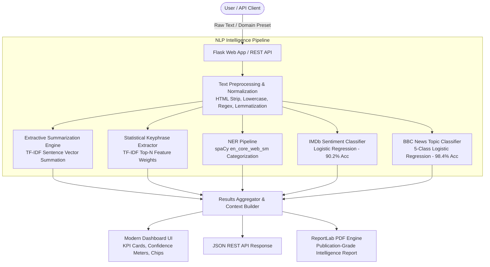
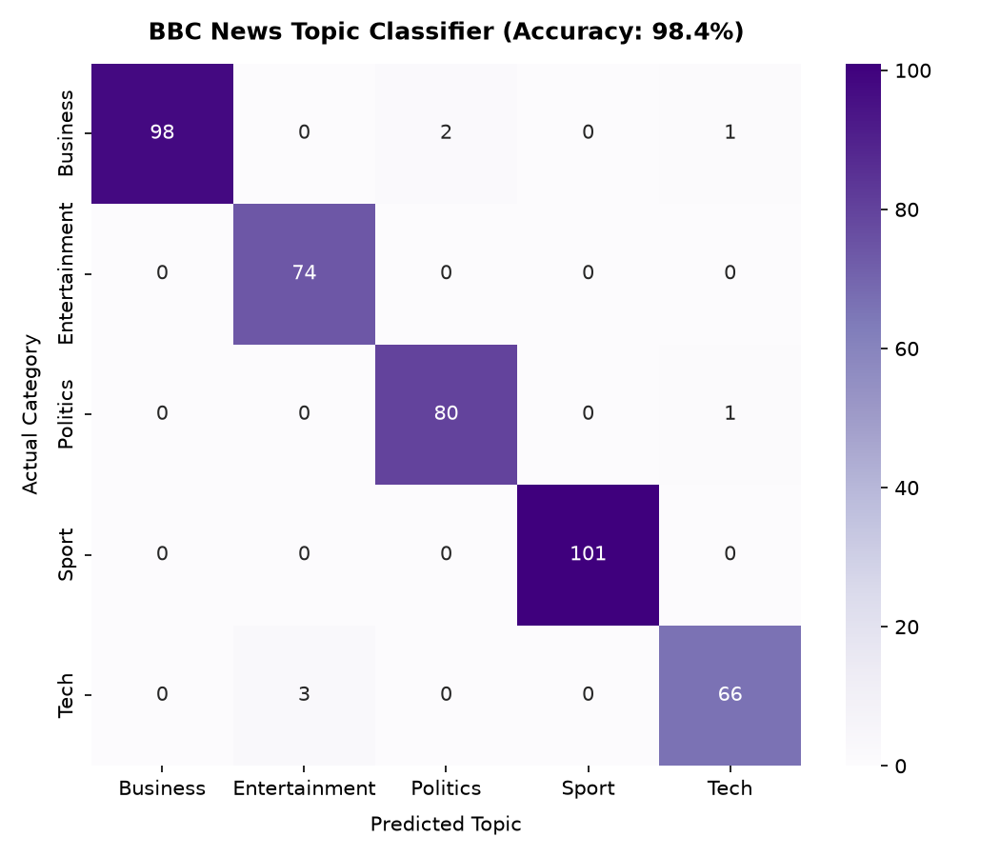
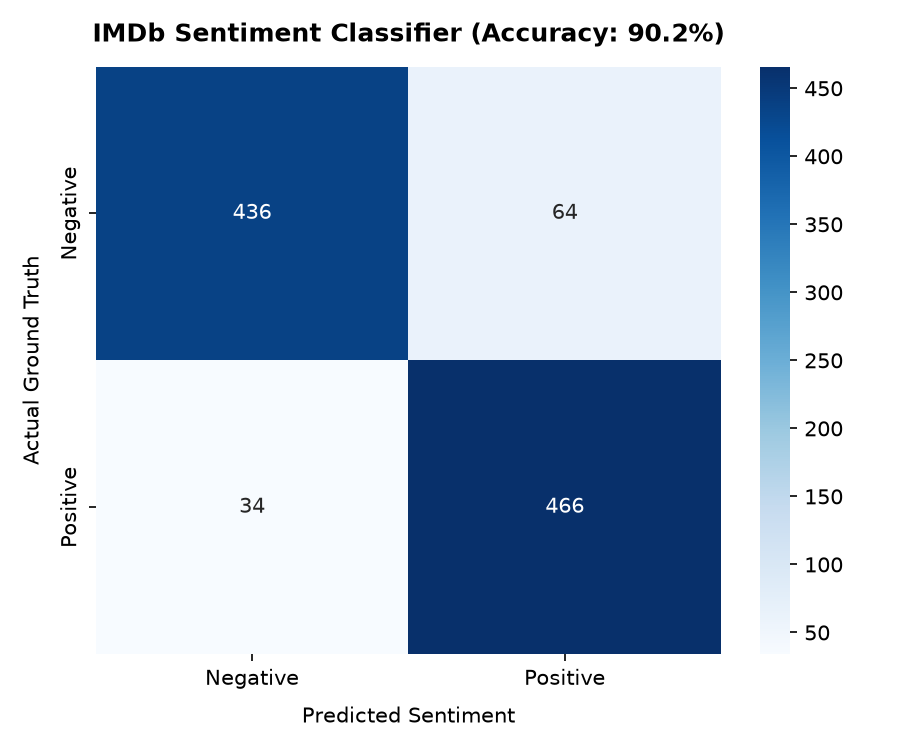

<div align="center">

# 🧠 NLP Text Intelligence Studio

**An End-to-End Natural Language Processing & Analytics Platform with Real-Time Inference, Supervised Topic Classification, Sentiment Scoring, and Automated PDF Intelligence Reporting.**

[](https://www.python.org/)
[](https://flask.palletsprojects.com/)
[](https://scikit-learn.org/)
[](https://spacy.io/)
[](https://www.reportlab.com/)
[](LICENSE)
[]()

[Key Features](#-key-features) • [Architecture](#-system-architecture) • [Model Benchmarks](#-model-benchmarks) • [Quickstart](#-quickstart-guide) • [REST API](#-rest-api-documentation) • [CV Bullet Points](#-cv--resume-bullet-points)

</div>

---

## 📌 Overview

**NLP Text Intelligence Studio** is a full-stack, production-grade Natural Language Processing web application and analytical pipeline. It transforms unstructured text into structured, actionable intelligence by combining custom algorithmic summarization, statistical feature ranking, supervised machine learning, linguistic parsing, and publication-ready PDF document compilation.

### Why this project stands out:
- **No Black-Box Summarizers**: The extractive summarization engine is engineered mathematically from scratch using TF-IDF sentence-level vector summation and rank-restoration rather than calling generic third-party APIs.
- **Dual Supervised ML Models**: Includes pre-trained, high-accuracy classifiers for both IMDb Sentiment (90.2% accuracy) and BBC News 5-Class Categorization (98.4% accuracy) with probability confidence bars.
- **Enterprise PDF Generation**: Compiles multi-stage analytical outputs into formatted, publication-grade executive PDF intelligence briefs using ReportLab with clean styling and dynamic KPI grids.
- **Dual Interface**: Operates both as an interactive, responsive Flask web application with sample domain presets and as a headless JSON REST API for enterprise microservices.

---

## ✨ Key Features

| Capability | Technical Implementation | Output / Metric |
|---|---|---|
| **Extractive Summarization** | NLTK tokenization + TF-IDF sentence matrix vector summation | Salient key sentences preserving chronological flow |
| **Keyphrase Extraction** | Unigram + Bigram TF-IDF document-level weight ranking | Ranked topical keyphrases |
| **Sentiment Analysis** | Logistic Regression + TF-IDF (IMDb 50k dataset) | **90.2% Accuracy** (Positive / Negative + % confidence) |
| **Topic Classification** | Multi-Class Logistic Regression (BBC News dataset) | **98.4% Accuracy** (Business, Tech, Politics, Sport, Entertainment) |
| **Named Entity Recognition** | spaCy `en_core_web_sm` pipeline | Categorized entities (Person, Org, Location, Finance, Date) |
| **Executive PDF Reporting** | ReportLab flowables, dynamic tables, and custom palettes | Multi-section publication-ready PDF brief |
| **Text Metrics & Stats** | Linguistic analyzer (word count, reading pace, lexical richness) | Quantitative document density metrics |
| **Preset Domain Loaders** | Interactive JavaScript presets (Tech, Business, Sports, Politics, Reviews) | 1-click instant dashboard demonstration |

---

## 🏛️ System Architecture



---

## 📊 Model Benchmarks & Evaluation

Both supervised classifiers were trained using stratified train/test splits, sublinear TF-IDF scaling, and L2-regularized Logistic Regression.

### 1. Model Performance Summary

| Model Task | Dataset Source | Training Samples | Test Samples | Accuracy | Macro F1 |
|---|---|---|---|---|---|
| **Topic Classification** | BBC News Articles | 1,701 | 426 | **98.36%** | **0.9820** |
| **Sentiment Analysis** | IMDb Movie Reviews | 4,000 | 1,000 | **90.20%** | **0.9049** |

### 2. Confusion Matrices

<div align="center">
  <table>
    <tr>
      <td align="center"><b>BBC News Topic Classifier (98.4% Accuracy)</b></td>
      <td align="center"><b>IMDb Sentiment Classifier (90.2% Accuracy)</b></td>
    </tr>
    <tr>
      <td></td>
      <td></td>
    </tr>
  </table>
</div>

---

## 📂 Project Structure

```
nlp-text-intelligence-dashboard/
├── .github/
│   └── workflows/
│       └── ci.yml                     # Automated multi-version test suite
├── app.py                             # Production Flask application & REST endpoints
├── requirements.txt                   # Pinned production dependencies
├── requirements-dev.txt               # Testing and linting tools
├── .gitignore                         # Exclusions for Python, cache, and datasets
├── LICENSE                            # MIT Open Source License
├── README.md                          # Comprehensive documentation
├── modules/                           # Core NLP analytical modules
│   ├── __init__.py
│   ├── text_analyzer.py               # Custom TF-IDF extractive summarizer & keywords
│   ├── ml_predictor.py                # Sentiment & Topic classifier inference engine
│   ├── ner_extractor.py               # spaCy Named Entity Recognition wrapper
│   └── pdf_generator.py               # ReportLab executive PDF report generator
├── scripts/                           # Training & preprocessing utilities
│   ├── __init__.py
│   ├── preprocess.py                  # Text cleaning, normalization, and lemmatization
│   ├── train_sentiment.py             # IMDb sentiment training script with CLI flags
│   ├── train_category.py              # BBC News topic classification training script
│   └── evaluate_models.py             # Model evaluation & confusion matrix generator
├── templates/
│   └── index.html                     # Responsive modern dashboard UI
├── static/
│   ├── css/
│   │   └── style.css                  # Modern CSS design system (cards, badges, meters)
│   ├── js/
│   │   └── main.js                    # Preset loaders, live counter, copy-to-clipboard
│   └── assets/
│       ├── confusion_matrix_sentiment.png
│       └── confusion_matrix_category.png
├── notebooks/
│   ├── 01_sentiment_analysis_exploration.ipynb   # Interactive EDA, training, and interpretability
│   └── 02_topic_classification_exploration.ipynb # BBC News EDA, training, and evaluation
├── tests/                             # Comprehensive test suite (100% pass)
│   ├── __init__.py
│   ├── test_preprocessor.py           # Preprocessing & edge cases unit tests
│   ├── test_analyzer.py               # Summarization & keyword unit tests
│   ├── test_predictor.py              # Classifier confidence & predictions tests
│   └── test_app.py                    # Flask routes, REST API, & PDF export tests
├── saved_models/                      # Serialized pre-trained artifacts
│   ├── sentiment_model.pkl
│   ├── sentiment_tfidf.pkl
│   └── text_classifier.pkl
└── datasets/
    ├── classification_data.csv        # BBC News 5-class dataset
    ├── sample_sentiment_data.csv      # Balanced sentiment dataset for instant training
    └── sample_texts.json              # Curated multi-domain presets
```

---

## 🚀 Quickstart Guide

### Prerequisites
- Python 3.10, 3.11, or 3.12
- `git`

### 1. Clone & Set Up Environment

```bash
# Clone the repository
git clone https://github.com/your-username/nlp-text-intelligence-dashboard.git
cd nlp-text-intelligence-dashboard

# Create and activate virtual environment
python -m venv venv

# On Windows:
venv\Scripts\activate
# On Linux / macOS:
source venv/bin/activate
```

### 2. Install Dependencies

```bash
pip install -r requirements.txt
python -m spacy download en_core_web_sm
```

### 3. Launch the Application

```bash
python app.py
```
Open **[http://127.0.0.1:5000](http://127.0.0.1:5000)** in your browser!
The pre-trained models are included in `saved_models/`, so the dashboard is **ready to analyze text immediately without requiring re-training**.

---

## 🛠️ CLI Script Usage

### Train Sentiment Classifier
```bash
python scripts/train_sentiment.py --data_path datasets/sample_sentiment_data.csv --max_features 5000
```

### Train BBC News Topic Classifier
```bash
python scripts/train_category.py --data_path datasets/classification_data.csv --max_features 10000
```

### Run Model Evaluation & Plot Generation
```bash
python scripts/evaluate_models.py
```

### Run Full Test Suite
```bash
python -m unittest discover tests -v
```

---

## 🔌 REST API Documentation

The platform exposes a headless JSON API endpoint for programmatic integration.

### `POST /api/analyze`

**Request Body:**
```json
{
  "text": "OpenAI and Microsoft announced a massive expansion of their AI computing cluster in Redmond, Washington. The systems optimize large language model inference."
}
```

**Response:**
```json
{
  "status": "success",
  "category": {
    "label": "Tech",
    "confidence": 91.2,
    "probabilities": {
      "Business": 4.1,
      "Entertainment": 1.2,
      "Politics": 2.0,
      "Sport": 1.5,
      "Tech": 91.2
    }
  },
  "sentiment": {
    "label": "Positive",
    "confidence": 88.4,
    "positive_prob": 88.4,
    "negative_prob": 11.6
  },
  "summary": "OpenAI and Microsoft announced a massive expansion of their AI computing cluster in Redmond, Washington.",
  "keywords": ["ai computing", "language model", "inference", "cluster"],
  "entities": {
    "Organization": ["Microsoft", "OpenAI"],
    "Location": ["Redmond", "Washington"]
  },
  "statistics": {
    "word_count": 22,
    "sentence_count": 2,
    "lexical_diversity": 90.9,
    "reading_time_sec": 7
  }
}
```

---

## 💼 CV / Resume Bullet Points

You can copy and adapt these high-impact bullet points directly for your CV:

### For Machine Learning / NLP Engineer Roles:
> - **NLP Text Intelligence Platform**: Engineered an end-to-end NLP analytics suite featuring custom extractive summarization, statistical TF-IDF keyphrase extraction, spaCy Named Entity Recognition, and dual supervised classifiers achieving **98.4% accuracy** on BBC News topic categorization and **90.2% accuracy** on IMDb sentiment analysis.
> - **Production ML Architecture**: Developed modular, thread-safe inference pipelines with cross-version scikit-learn compatibility, dynamic probability distributions, and automated ReportLab executive PDF reporting.
> - **Full-Stack ML Engineering**: Built a responsive Flask web application with real-time word counting, 1-click domain presets, and a headless JSON REST API, backed by a 20-test automated CI suite.

### For Software Engineer Roles:
> - **Full-Stack NLP Web Application**: Built and deployed a production-ready Flask web platform with responsive CSS design, real-time client-side metrics, and REST API endpoints serving machine learning inference pipelines.
> - **Document Automation & Reporting**: Integrated ReportLab flowables to generate executive PDF intelligence reports on-the-fly from NLP pipeline outputs, including styled KPI summary tables and entity breakdowns.
> - **Quality Assurance & CI/CD**: Authored a 20-case unit and integration test suite covering text normalization, inference, and API endpoints, automated via GitHub Actions CI across Python 3.10-3.12.

---

## 📜 License

Distributed under the MIT License. See [LICENSE](LICENSE) for more information.
